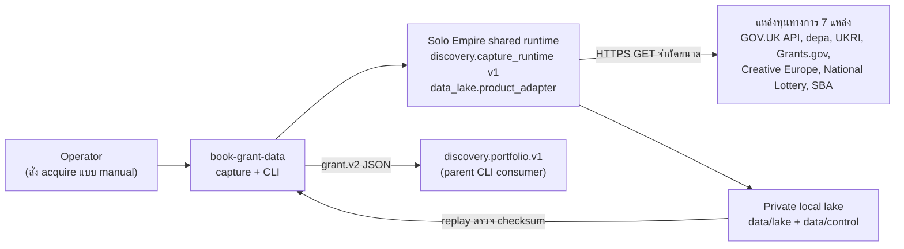
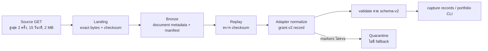
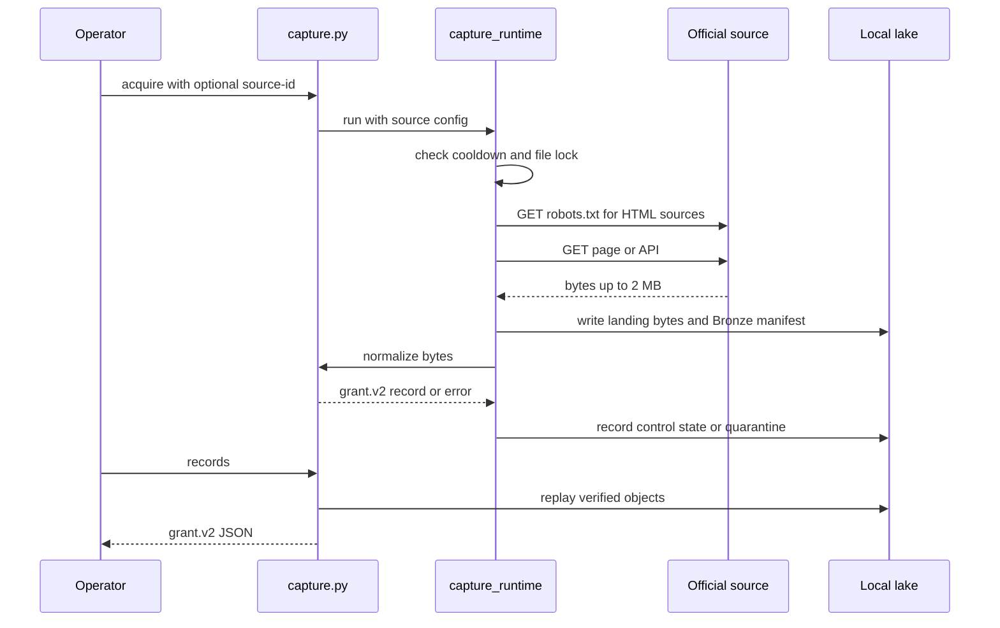

# Book Grant Data — System Architecture

## 1. Context diagram

## 2. Components

| Component | ไฟล์ | หน้าที่ |
|---|---|---|
| Contract CLI | `src/book_grant_data/cli.py` | `contract`, `validate`, `demo`; ไม่มี dependency กับ parent; ไม่บันทึกไฟล์ที่รับเข้า |
| Contracts | `schema.json` (`grant.v1`), `schema-v2.json` | JSON Schema; v2 เพิ่ม `record_kind` และให้ domain terms เป็น `null` ได้ |
| Synthetic fixture | `demo.json` | ข้อมูลสังเคราะห์ นาฬิกาคงที่ 2026-09-07T00:00:00Z |
| Source policy | `source.json`, `source-*.json` (รวม 7) | URL, วิธีเข้าถึง, markers, `permission_evidence`, `min_interval_seconds`, retention |
| Source registry | `sources.json` | รายการแหล่งที่เปิด, candidate ที่ถูกปิด, `permission_status` |
| Capture adapter | `src/book_grant_data/capture.py` | เลือก source, normalize เป็น record v2, แปลงเวลาปิดรับแบบ UK เป็น UTC, เรียก shared runtime |
| Shared runtime (นอก repo) | `(solo-empire) infra/scripts/discovery/capture_runtime.py` | HTTP GET, robots, cooldown, lock, landing/Bronze, quarantine |

## 3. เส้นทางข้อมูล (sources → ingestion → lake → consumers)

## 4. Tech stack

- Python ≥ 3.10 (CI ทดสอบ 3.10 และ 3.13), setuptools
- `jsonschema==4.19.2`, `tzdata` (เฉพาะ Windows) สำหรับ `ZoneInfo('Europe/London')`
- Dev: `pytest>=8`, `ruff==0.16.9`
- Capture lane ใช้ Python environment ของ parent (`infra/.venv-datalake`, มี pyarrow) **[ต้องยืนยัน]** รายการ package ที่แน่นอน

## 5. Data stores

| Store | ที่ตั้ง | เนื้อหา | หมายเหตุ |
|---|---|---|---|
| Landing | `data/lake/` (ใน repo, ถูก `.gitignore`) | bytes ต้นฉบับ + checksum | private, ไม่ republish |
| Bronze | `data/lake/` | document metadata row (Parquet) + manifest | ผ่าน `data_lake.product_adapter` |
| Control state | `data/control/` | เวลาตรวจล่าสุด, สถานะ quarantine ต่อ source | ใช้คุม cooldown 6 ชั่วโมง |
| Package resources | `src/book_grant_data/*.json` | schema, fixture, source policy | version-controlled |

ไม่มีฐานข้อมูลอื่น ไม่มี cloud storage และไม่ใช้ lake ที่กำหนดจาก environment

## 6. Integrations

| ระบบ | ทิศทาง | Contract |
|---|---|---|
| แหล่งทุนทั้ง 7 | ขาเข้า (HTTPS GET อ่านอย่างเดียว) | GOV.UK Content API (OGL v3.0) / HTML ที่ผ่าน robots.txt |
| Shared capture runtime | in-process import จาก `SOLO_EMPIRE_ROOT` | `discovery.capture_runtime.VERSION == 1` |
| `discovery.portfolio.v1` | ขาออก (อ่าน CLI) | `grant.v2` |
| Parent registries (`projects.yaml`) | เอกสาร | ยังระบุ `grant.v1`; ต้องบันทึก migration (`grt-t6`) |

## 7. Deployment topology

ไม่มี deployment: ทุกอย่างรันบนเครื่อง operator CI รันเฉพาะ test แบบ offline ไม่มี runtime port
schedule ทุก 6 ชั่วโมงผ่าน Windows Task Scheduler มีสคริปต์ใน parent
(`infra/scripts/discovery/setup_windows_task.ps1`) แต่ยังไม่ได้ติดตั้งสำหรับ grant (`grt-g3`)

## 8. ADR สำคัญ

| ID | การตัดสินใจ | เหตุผล | สถานะ |
|---|---|---|---|
| ADR-01 | เก็บ exact bytes ก่อน parse และ replay จาก landing/Bronze | ตรวจย้อนได้, parse ใหม่ได้โดยไม่ต้องดึงซ้ำ | ใช้อยู่ |
| ADR-02 | `null` = ไม่รู้ ไม่ใช่ศูนย์/ฟรี/มีสิทธิ์; ไม่รวม value kind ต่างชนิดเป็นเงินสด | ป้องกันการกล่าวอ้างเกินจริง | ใช้อยู่ |
| ADR-03 | Fail closed: source ที่ไม่ลงทะเบียน, markers ไม่ครบ, fetch ล้มเหลว → ไม่มี fallback | ไม่ให้ข้อมูลสังเคราะห์/เก่าปนข้อมูลจริง | ใช้อยู่ |
| ADR-04 | contract แตกเวอร์ชันแยก (v1 คงไว้, v2 สำหรับ captured) | ไม่ทำลาย reader เดิม | ใช้อยู่ |
| ADR-05 | ใช้ shared runtime จาก parent แบบระบุ path ชัด แทน vendoring | หลีกเลี่ยงการซ้ำ runtime | ชั่วคราว — ยังไม่ deploy แยกได้ |
| ADR-06 | เป็นฐาน merge ของ discovery family (ดู `D-01` ใน PRD) | ลดโค้ดซ้ำ 13 repo | **[ต้องยืนยัน]** |

## การอนุมัติ

| บทบาท | สถานะ | วันที่ | ลงนาม |
|---|---|---|---|
| Solution Architect (Book Dev) | รอพิจารณา | — | ________ |
| Product owner (Book Dev) | รอพิจารณา | — | ________ |

## แหล่งข้อมูล

- `README.md`
- `pyproject.toml`
- `sources.json`
- `src/book_grant_data/capture.py`
- `src/book_grant_data/cli.py`
- `src/book_grant_data/schema-v2.json`
- `.github/workflows/ci.yml`
- `(solo-empire) infra/scripts/discovery/capture_runtime.py`
- `(solo-empire) systems/architecture/discovery-portfolio.md`
- `(solo-empire) repository-catalog/roadmaps/data-scrapers.yaml`
